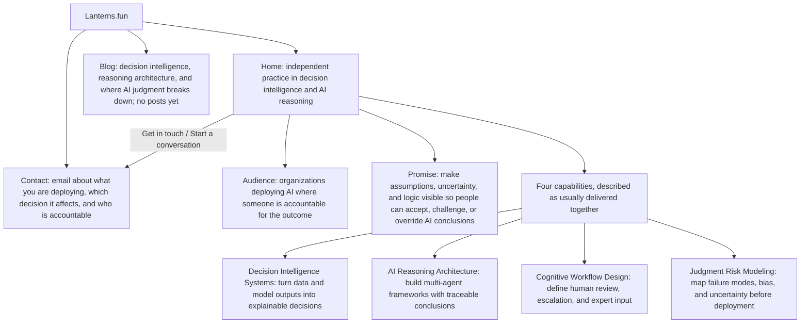

# Lanterns.fun: site positioning review

The [revised homepage](../index.html) presents the company name, “Software, data, and AI,” and a footer with the legal name and email. It does not list services or mention the framework. The Blog and Contact pages remain at their existing URLs but are not linked from the homepage.

## Before the homepage change

This map describes the original site's claims, not a verified list of services or past work.

## What to assess

- **Who's being hired?** The site says "independent practice," but uses "we" and doesn't identify who does the work or explain that the limited company is how you contract. A visitor could read it as a specialist consultancy rather than an individual contractor working through a company.
- **What's actually on offer?** "Four capabilities, usually delivered together" sounds like an established service package. For each capability, mark it as **work I take on**, **an area of interest**, or **not part of my offer**.
- **Which inquiries should the site attract?** The homepage and contact page both ask about AI deployments where decisions need to be defensible. If that's only one kind of contract you want, the current framing gives other prospective clients little reason to get in touch.

Related pages: [Blog](../blog.html), [Contact](../contact.html).
